# PyScribe

PyScribe is a local transcription app for Windows and Linux built primarily on `faster-whisper`, with experimental Granite Speech (file-based) and Nemotron Speech Streaming (English, live and file) support.
It supports both a Qt desktop UI and a Gradio listener UI, with optional speaker diarization and optional visual OCR analysis for video files.

## Documentation

- `docs/user_guide.md` - full feature guide for Qt, Listener, CLI, and environment settings.
- `docs/qt_help.md` - in-app Qt help content.
- `docs/ui_redesign_2026-10.md` - the October 2026 UX/UI redesign: structure, decisions, shortcuts, how to regenerate screenshots, and what still needs a check on real hardware.
- `docs/mcp.md` - using PyScribe as an MCP server from Claude Code, Codex, and other clients.
- `docs/handoff_2026-10-08_ux-ai-mcp.md` - state of the UX/theme/AI/MCP work, open items, and notes for the next session.
- `docs/handoff_2026-10-09_orchestration.md` - latest handoff: what shipped in the third session, maintainer decisions, open items, and the multi-session workflow.
- `docs/ocr_backend_check_2026-10.md` - OCR backend check and the PaddleOCR offline-manifest decision.
- `docs/upgrade_2026-10.md` - October 2026 runtime/accuracy upgrade: results, decisions, setup notes, how to reproduce.
- `CONTRIBUTING.md` - development and contribution workflow.
- `SECURITY.md` - vulnerability reporting and security guidance.
- `CHANGELOG.md` - project change history.

## Highlights

- Local transcription using `faster-whisper`
- Experimental Nemotron Speech Streaming (`nvidia/nemotron-speech-streaming-en-0.6b`, English only): punctuated, truecased text from a 0.6B cache-aware streaming model; works for Qt live mode (text appears about 1-2 s behind speech) and for file transcription with speaker identification. The Names / terms field is applied as a spelling-correction pass on the final transcript (no decoder biasing; live text shows raw output until then). About 2 GB of VRAM.
- Experimental Granite Speech file transcription (`granite-4.0-1b-speech` and `granite-speech-4.1-2b`; 4.1 returns punctuated, capitalized text and honours the Names / terms field)
- Hardware-aware model recommendations
- Qt desktop mode and Gradio listener mode
- Qt studio layout: a small navigation rail (Projects, Transcribe, Live, Templates, Settings) around two main experiences, a **Projects Home** for starting and resuming work and a **Transcript Studio** for reviewing it
- Every finished job is saved automatically as a project (transcript, timed speaker segments, speaker names, AI outputs) on this device
- Transcript Studio: speaker-badged transcript with the playing line highlighted, click-to-seek, inline editing, search with match count (`Ctrl+F`), a waveform and playback bar (seek, skip, speed), an inspector (Summary, Action items, Speakers, Visuals) and export to text, Markdown, SRT, WebVTT or JSON
- Calm while working: a slim job status bar (stage, elapsed time, cancel) appears only while work is active; the stage timeline, event log and hardware traces sit behind Details and Performance drawers
- Light and dark themes that follow the system colour scheme, with a bundled font so Linux and Windows look the same
- Settings in sections: appearance and accessibility (theme, colours, transcript text size, reduce motion), privacy and storage (projects folder), AI connections, start-up defaults and diagnostics; window size, rail state, theme and last-used run options are remembered
- Templates page for browsing, previewing and managing the prompt templates used for summaries and action items
- MCP server (`python main.py mcp`): Claude Code, Codex, and other MCP clients can transcribe audio, run OCR on a video or image (`analyze_visuals`), read your transcripts, and run a saved template through your own LLM profile (`run_template`; cloud profiles are refused unless `PYSCRIBE_MCP_ALLOW_CLOUD=1`), with your own subscription doing the AI work (see [docs/mcp.md](docs/mcp.md))
- AI summaries and action items from local, LAN, or hosted models (Claude via the native API; OpenAI, Gemini, OpenRouter and other OpenAI-compatible services), with automatic splitting of long transcripts and per-connection token and temperature settings
- Optional Claude Code CLI provider (`claude_cli`, personal use only): post-processing through your own signed-in `claude` program instead of an API key
- LLM API keys can be kept in the operating system keyring (optional `keyring` package) instead of only for the session
- Colour themes: five presets (Graphite Studio, the default, plus Iron-gall, Verdigris, Ochre, Graphite) and your own, with a palette editor, live preview, automatic contrast fixes, and import/export; the Listener uses the same choice
- One job timeline showing each stage (Load model, Transcribe, Speakers, Visuals, Save) with its state and elapsed time; the Listener shows the same stages as a stage strip under Status
- Performance drawer with 60-second CPU, memory, GPU, and VRAM traces coloured by the running stage
- Qt live transcription mode for microphone or loopback capture (Linux-first)
- Qt batch transcription queue for sequential processing of multiple files or entire folders
- Batch queue support for same-named files from different folders
- Live pause/resume during Qt capture without breaking the current session folder
- Hide/show control for the left navigation rail
- Keyboard-reachable controls with visible focus and selected states, and a reduce-motion setting
- Optional speaker diarization with selectable backend
- Optional visual analysis (OCR on sampled video frames)
- Live status, progress, and transcript updates
- Pipeline log in Qt in the Job details drawer
- Qt controls for pause, cancel, and force stop
- Save modes: combined output, transcript-only, OCR-only
- Optional Hugging Face token support for gated/private model access
- Qt LLM connection profiles (local, LAN, or hosted) with connection diagnostics
- Qt LLM post-processing for current transcript or previously saved transcript files
- Qt LLM split workspace with configuration/attachments panel and structured context/preview/output panes
- LLM generation cancel flow with confirmation and safe close behavior while generation is active
- Listener with the same hierarchy: basics up front, an Advanced section, and Transcript / AI summary tabs; template-based LLM processing of current or uploaded transcripts
- User template management (custom prompt templates) and payload preview before send
- Optional screenshot/image attachments with multimodal send or OCR fallback for text-only models
- LLM connection manager with subnet detection + LAN scan and explicit LM Studio provider support

## Screenshots

> **Note:** All screenshots show the October 2026 redesign. They are rendered offscreen with Qt using synthetic data (`scripts/capture_screenshots.py`), so they contain no personal transcripts or file names.

### Projects Home

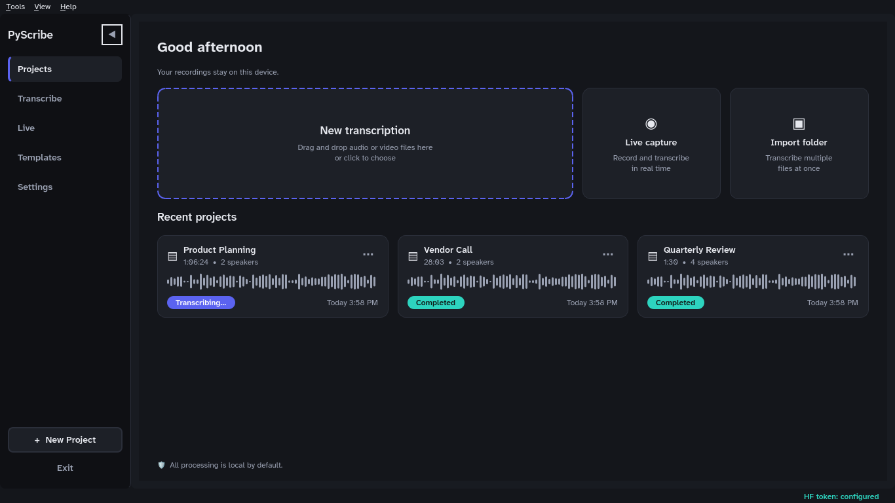

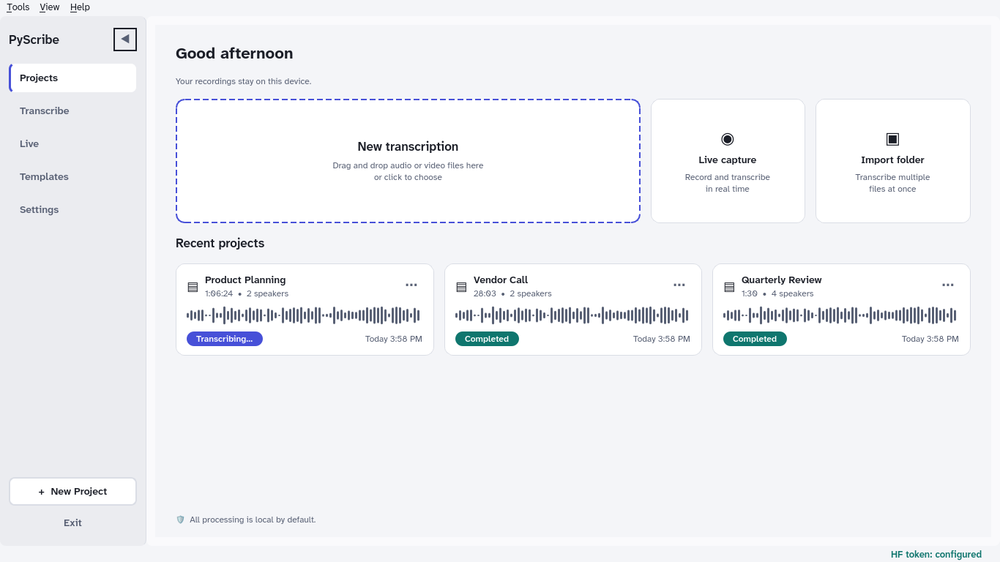

### Transcript Studio

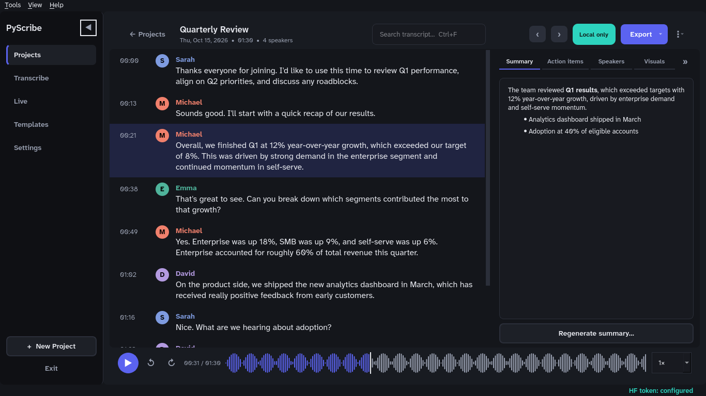

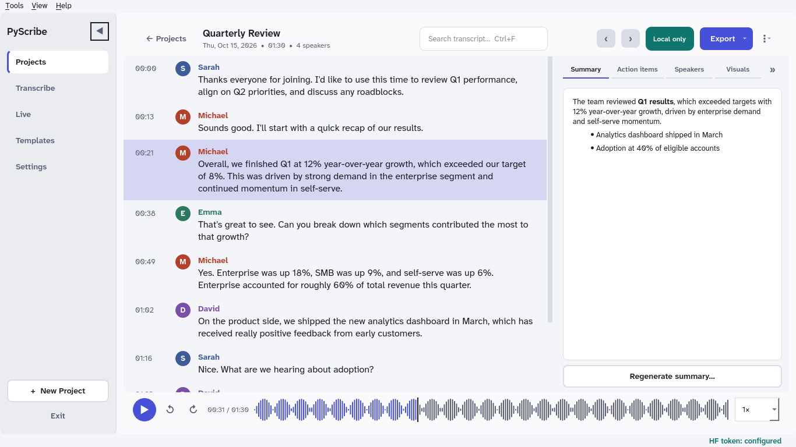

### Transcribe

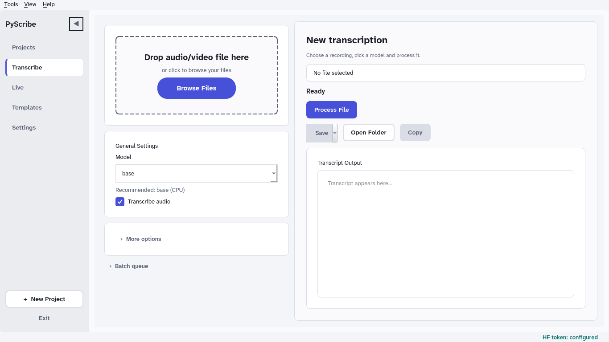

### Live Capture

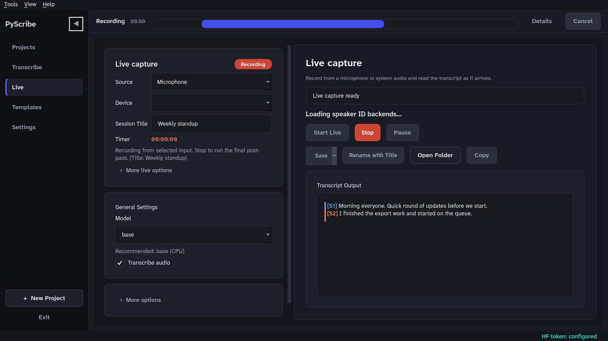

### Templates

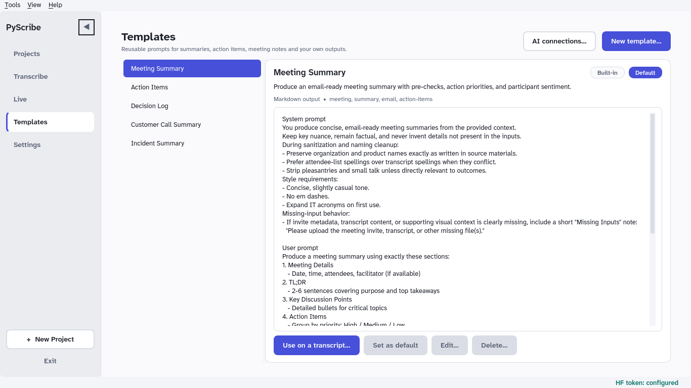

### Settings and Colour Themes

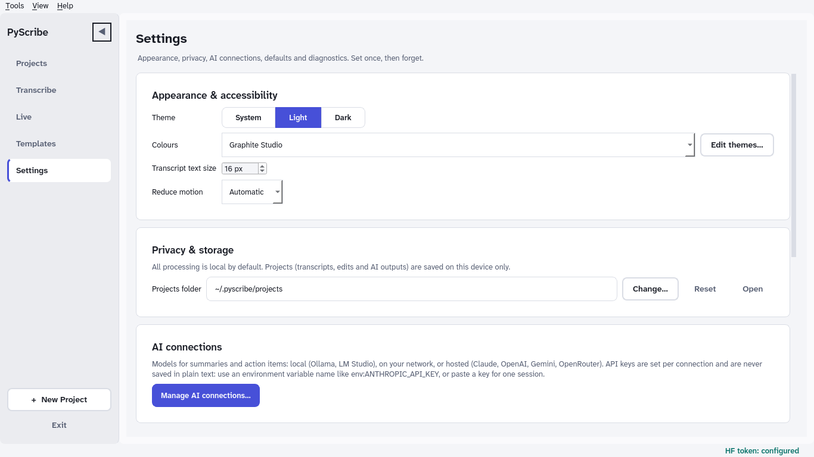

Pick a theme under **Settings > Appearance & accessibility** (or **View > Colour theme**); **Edit themes...** opens the editor.

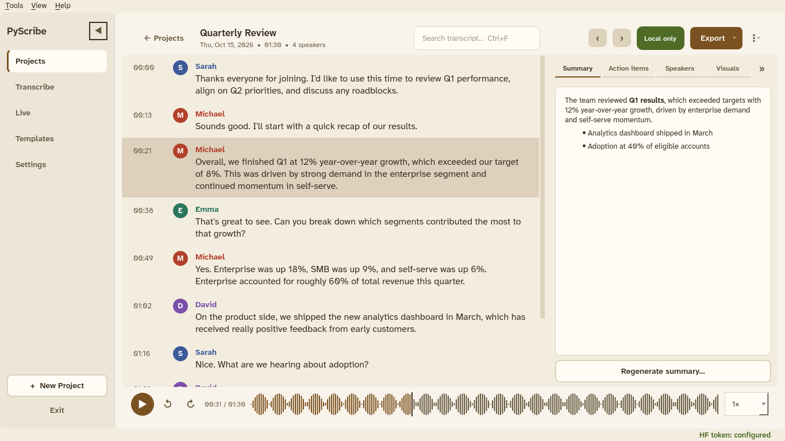

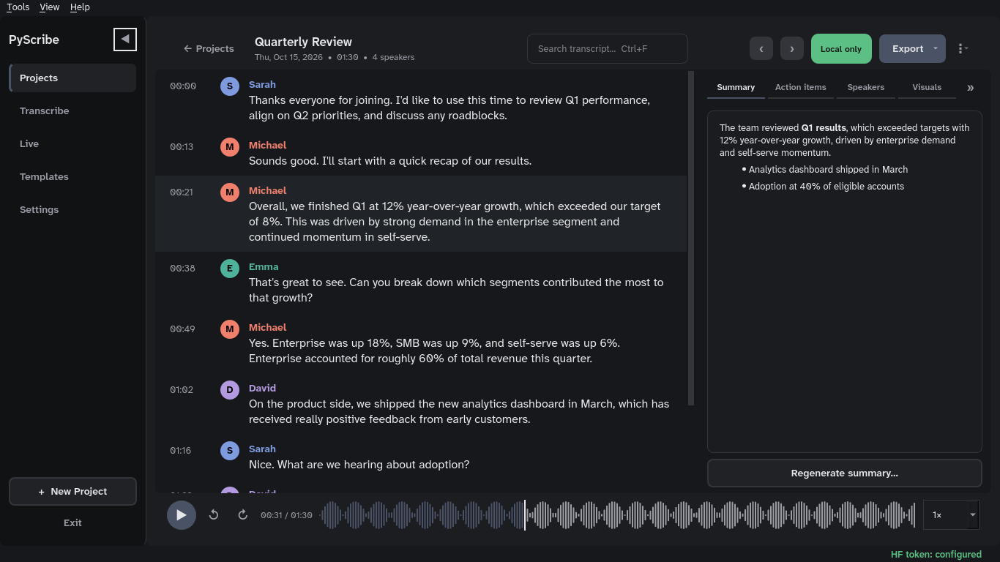

### Qt Tools: Hugging Face Token

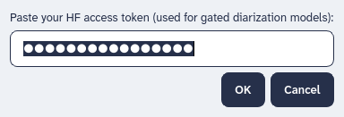

### Qt Tools: Benchmark

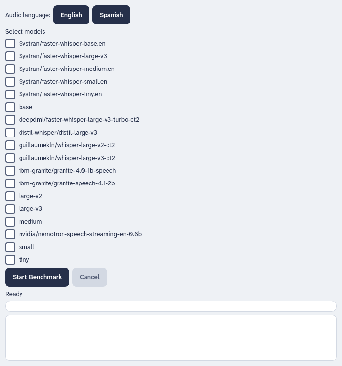

### Qt Tools: LLM Connections

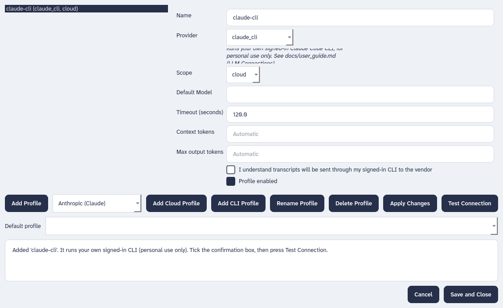

### Listener (Gradio Web UI)

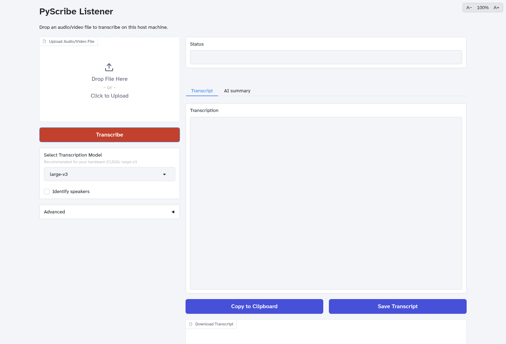

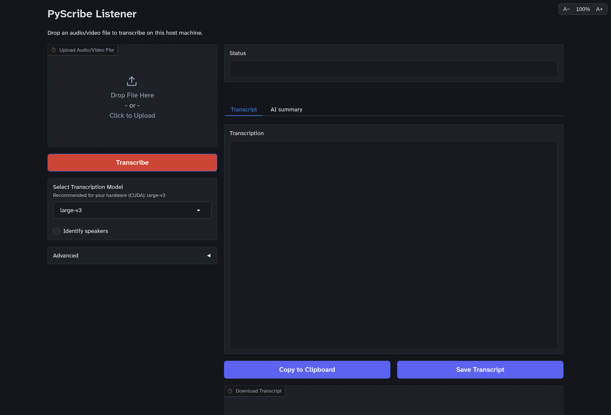

Use the **A− / A+** widget in the top-right corner to change the Listener text size (80%–200%); click the percentage to reset. The size is remembered per browser.

## Recent Updates (Unreleased)

See `CHANGELOG.md` for the full unreleased change list. Notable current updates include:

- UX/UI redesign: Projects Home and Transcript Studio, a navigation rail, a job status bar with Details and Performance drawers, a sectioned Settings page, a Templates page, a Live page with a clear recording state, the Graphite Studio default theme, and the same hierarchy in the Listener. The movable dock panels are gone (`docs/ui_redesign_2026-10.md`).
- Qt live transcription with microphone/loopback capture, rolling ASR, autosaved session folders, final post-pass cleanup, **Pause / Resume**, confirmed cancel, VRAM preflight warnings, and session-title-based naming/rename support.
- Qt batch queue support for sequential processing of files or folders, including same-named files from different folders.
- Safer pyannote diarization through spawned subprocess isolation, `soundfile` audio-loading fallbacks, CUDA-to-CPU retry, and plain transcript fallback when no speaker segments are produced.
- Shared listener security/auth validation, restricted non-local/public listener exposure, and rejection of legacy `--auth-pass` CLI secrets.
- Consolidated `pyscribe.log` logging with timestamped archive rotation.
- Qt dashboard/sidebar refresh, responsive transcription cards, hide/show side panels, clickable drop zone, and terminal-style live pipeline logs.
- A job-stage timeline, hardware traces, light/dark themes with colour presets and a theme editor, speaker-coloured transcripts, working start-up defaults, and a refreshed Listener look (see `CHANGELOG.md`); the Qt layout around them was then redesigned (above).
- Hosted AI providers (Claude, OpenAI, Gemini, OpenRouter) alongside local and LAN models, with automatic splitting of long transcripts, and an MCP server for Claude Code, Codex, and other clients (`docs/mcp.md`).
- MCP `analyze_visuals` (OCR of a video or image) and `run_template` tools, an optional Claude Code CLI provider (`claude_cli`), OS keyring storage for LLM API keys, a Listener stage strip, Load model and Save rows in the Qt timeline, a live-mode Compute/Precision selector, an OCR fallback setting, and a working New Project button.
- Qt and Listener LLM post-processing with prompt templates, user template management, payload preview, optional image attachments, OCR fallback, and safe cancellation.
- LLM connection profile diagnostics with local/LAN/cloud scope policy, subnet detection, LAN scan, LM Studio support, profile rename, and secure `env:VAR_NAME` API key references.

## Requirements

- Python 3.10+ (3.12 recommended)
- FFmpeg available in PATH
  - Windows: `winget install Gyan.FFmpeg`
  - Ubuntu/Debian: `sudo apt install ffmpeg`
- NVIDIA GPU is highly recommended. The provided `requirements.txt` pins PyTorch 2.11 with CUDA 12.8 wheels (NVIDIA driver 570 or newer); CPU-only or different-CUDA installs may need a custom Torch install before the rest of the requirements.
- `torchcodec` (needed by pyannote.audio 4.x) loads FFmpeg 4-8 shared libraries; on systems shipping a newer FFmpeg it prints a warning at startup.
- Optional OCR runtime:
  - RapidOCR (`rapidocr-onnxruntime`, included in core requirements)
  - `pytesseract` + OS `tesseract` executable
  - PaddleOCR 3.x (`paddleocr` + `paddlepaddle`, included in `requirements.txt`). The default CPU `paddlepaddle` build takes about 5 s per frame; run `scripts/install_paddle_gpu.sh` to swap in the CUDA build (about 0.08 s per frame, about 1.2 GB VRAM). `auto` OCR prefers PaddleOCR only when it will run on the GPU, otherwise RapidOCR.
  - Surya OCR runtime dependencies, if installed separately
- Optional: `keyring` (in `requirements.txt`) to store LLM API keys in the OS keyring; without a usable keyring the option is simply not offered
- Speaker diarization (optional at runtime):
  - `pyannote.audio` (pinned in `requirements.txt`) powers the `accurate` backend (the former `fast` mode was identical and has been removed; saved `fast` settings map to `accurate`); `off` skips diarization

## Installation

Upgrading from the CUDA 12.1 / PyTorch 2.5.1 stack: create a fresh venv and keep the old one until you have verified the new one (`python scripts/evaluate.py`). To roll back, reactivate the old venv or restore the previous pins with `git show <previous-commit>:requirements.txt > requirements.txt` and reinstall in a fresh venv.

### Windows

```bash
py -3.12 -m venv .venv
.\.venv\Scripts\activate
pip install -r requirements.txt
```

### Linux

```bash
sudo apt update
sudo apt install -y ffmpeg python3.12 python3.12-venv
python3.12 -m venv .venv
source .venv/bin/activate
pip install -r requirements.txt
```

With `uv` instead of `pip` (the requirements use several package indexes):

```bash
uv venv --python 3.12 .venv
uv pip install --python .venv/bin/python --index-strategy unsafe-best-match -r requirements.txt
```

### Optional: PaddleOCR on the GPU

`requirements.txt` installs the CPU `paddlepaddle` wheel. On an NVIDIA GPU, swap in the CUDA build afterwards (Linux):

```bash
scripts/install_paddle_gpu.sh            # uses .venv/bin/python; pass another Python path as the first argument
```

Re-run it after any `pip install -r requirements.txt`, which reinstalls the CPU wheel. It installs `paddlepaddle-gpu` without its pinned NVIDIA packages so it shares the CUDA libraries torch already installed. `pytest` is not in `requirements.txt`; install it separately to run the tests (`CONTRIBUTING.md`).

## Quick Start

```bash
# Interactive launcher menu (choose mode)
python main.py

# Qt desktop
python main.py qt

# Listener mode (localhost by default)
python main.py serve --port 7860

# MCP server on stdio (normally started by an MCP client; see docs/mcp.md)
python main.py mcp
```

Listener mode automatically moves to the next free port if the preferred port is occupied.

Interactive launcher behavior:

- If no option is chosen within 5 seconds, PyScribe automatically starts `1) Desktop (Qt)`.
- Choose `2) Listener` and then:
  - `1) Localhost only (127.0.0.1)` (default)
  - `2) LAN share (0.0.0.0)` with auth enabled
- Interactive LAN uses:
  - Username default: `pyscribe` (override with env var)
  - Password: from `PYSCRIBE_LAN_AUTH_PASS` or secure prompt at launch
- Override username/password with:
  - `PYSCRIBE_LAN_AUTH_USER`
  - `PYSCRIBE_LAN_AUTH_PASS`

## Listener Security

Binding to non-local interfaces is intentionally restricted.

- Local-only bind (safe default): `--host 127.0.0.1`
- Non-local bind requires:
  - `--allow-nonlocal-host`
  - `--auth-user <username>`
  - `PYSCRIBE_AUTH_PASS` environment variable
- Public share mode (`--share`) also requires auth credentials, even on localhost binds.
- Optional: set `PYSCRIBE_AUTH_USER` instead of passing `--auth-user`
- Legacy `--auth-pass` CLI flag is intentionally unsupported

Example:

```bash
PYSCRIBE_AUTH_USER=admin PYSCRIBE_AUTH_PASS=change-me \
python main.py serve --host 0.0.0.0 --allow-nonlocal-host --port 7860
```

Note: Interactive LAN mode no longer uses a default password. Set
`PYSCRIBE_LAN_AUTH_PASS` or enter a prompted password at launch.

## Models

- Built-in model choices are available in both UIs.
- `turbo` / `large-v3-turbo` select `deepdml/faster-whisper-large-v3-turbo-ct2`, available for both file and live transcription.
- Custom Hugging Face repo IDs are supported (for example `owner/repo`).
- Full Hugging Face model URLs are normalized to repo IDs.
- Qt mode asks for model download confirmation with a size estimate before first download.

## Feature Notes

- **Speed vs completeness:** file transcription decodes sequentially by default. The optional **Faster GPU decoding** setting batches decoding (size chosen from free VRAM; roughly 2.5x faster ASR on GPU, within ~0.3 pt WER on clean read speech) but on a real 32-minute interview it dropped filler words and some short replies (about 15% fewer words), so it is off by default. CPU always decodes sequentially.
- **Names / terms:** the optional field biases recognition toward names and jargon. Keep it short and relevant; irrelevant terms can raise the error rate.

- **Diarization:** optional; pyannote backends run in an isolated worker process, prefer `soundfile` audio loading, and retry on CPU when GPU diarization is unavailable. Modern Torchaudio compatibility shims provide `soundfile` fallbacks for metadata/loading APIs removed or changed in Torchaudio 2.9+ / 2.11. If diarization fails or produces no speaker segments, transcription completes without speaker labels instead of emitting `[S?]` lines.
- **File transcription:** applies VAD filtering to skip silence and runs video OCR concurrently with audio transcription when both are enabled.
- **Qt live mode:** Linux-first desktop feature for microphone or loopback capture. Live mode writes a recoverable timestamped `YYYY-MM-DD_HHMMSS-live-capture.wav` while showing rolling transcript text, supports **Pause / Resume** within the same session, and runs a final file-based cleanup pass when you press **Stop**. The **Compute** (Auto / CPU / GPU) and **Precision** (Auto / float16 / int8) selectors apply to the session and its final pass. Optional Session Title values can name live session outputs, and **Rename with Title** can apply a title after recording. Cancel asks for confirmation and preserves the session folder/audio when accepted. Speaker identification, when enabled, runs only in that final pass. With `nvidia/nemotron-speech-streaming-en-0.6b` the live text streams from the model as you speak and the final pass re-runs Nemotron on the saved capture (about 1 minute of ASR per hour of audio on a GPU) before diarization. Granite remains file-only.
- **Visual analysis:** optional; supports `fast`, `balanced`, `accurate` profiles, slides-only or slides+chat scope, and `auto`, `rapidocr`, `paddleocr`, `surya`, or `pytesseract` OCR backend selection. The **OCR Fallback** setting (`visual_ocr_fallback`) picks which backend is tried first when the main one cannot run. Long videos use lower frame caps and faster auto backend preference to keep webinar OCR practical.
- **Qt output save modes:** `Save All`, `Save Transcript Only`, `Save OCR Only`. When multiple processing parts are enabled, Qt also auto-saves separate `<stem>_transcript.txt`, `<stem>_diarized.txt`, and/or `<stem>_ocr.txt` files beside the source media.
- **Benchmarking:** Qt Tools menu includes benchmark runner for bundled sample media.
- **LLM post-processing:** Qt Tools menu includes connection management plus post-process actions.

## Testing

```bash
# Full suite
python -m pytest -q tests

# Quick smoke test
python -m pytest -q tests/smoke_cli.py
```

CI runs the CLI smoke checks plus `python -m pytest -q tests` in a light environment; test modules that need torch, Qt, or other heavy packages are skipped when those are not installed.

### Evaluation (WER / DER / speed)

`scripts/evaluate.py` measures transcription accuracy and speed against reference data so upgrades can be compared with a baseline:

```bash
pip install jiwer
python scripts/evaluate.py --device cuda --label baseline
python scripts/evaluate.py --device cpu --compute-type int8 --label baseline
```

It reports WER/CER (normalized text), real-time factor, and peak RAM/VRAM, and writes JSON to `eval_results/`. The default manifest (`evaluation/manifest.json`) covers the bundled LibriVox benchmark clips. Add your own recordings in a git-ignored `eval/manifest.json` (see the script docstring); an item with `reference_rttm` and `"diarize": true` also reports DER, `[S?]` line counts, and mislabelled segments.

`scripts/accuracy_sweep.py` compares faster-whisper settings (model, precision, beam size, repetition guards) on any manifest items that have reference text, scoring WER with and without filler words. `scripts/build_ami_refs.py` builds conversational references for public AMI meetings from AMI's manual annotations (CC BY 4.0), a better test than read speech for interviews and calls.

## CLI / Packaging

```bash
pip install .
pyscribe --help
```

- The console script is intended for use from a source checkout. Bundled docs, prompt templates, screenshots, benchmark audio, and helper scripts are not declared as packaged data in `pyproject.toml`.
- Listener helper script: `scripts/run_listener.sh`
- systemd example unit: `deploy/systemd/pyscribe-listener.service.example`

## Runtime Environment Defaults

PyScribe configures writable cache defaults for OCR/model assets when needed, including:
`PYSCRIBE_CACHE_DIR`, `PADDLE_HOME`, `PADDLE_PDX_CACHE_HOME`, `HF_HOME`, and `MODELSCOPE_CACHE`.

See `docs/user_guide.md` for all environment variables and behavior.

## License

PolyForm-Noncommercial-1.0.0

Commercial use is not permitted under the current project license.

## Acknowledgments

Benchmark audio source: [LibriVox](https://librivox.org/).

Nemotron Speech Streaming is [NVIDIA nemotron-speech-streaming-en-0.6b](https://huggingface.co/nvidia/nemotron-speech-streaming-en-0.6b), used under the NVIDIA Open Model License (the model is downloaded by the user on first use and is not redistributed with PyScribe).

Speaker diarization uses [pyannote.audio](https://github.com/pyannote/pyannote-audio) and the `pyannote/speaker-diarization-community-1` pipeline (CC-BY-4.0, by pyannoteAI).
